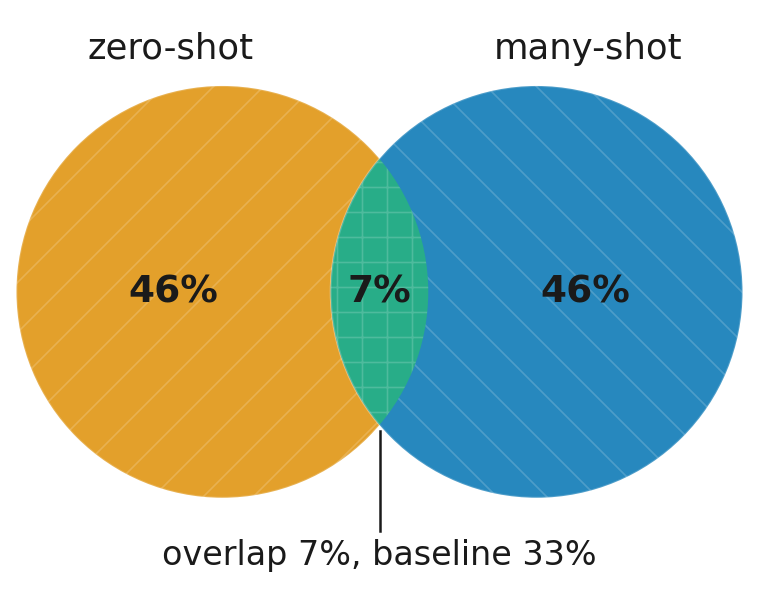
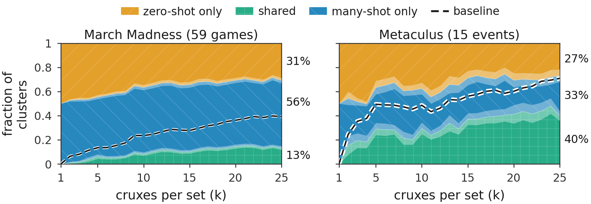

# forecast-cruxes-reproduce

Data and verification for "Can LLMs Anticipate Their Cruxes?" by David Reber, James Reber, Ari
Holtzman and Victor Veitch (University of Chicago). An arXiv preprint is forthcoming.

## Start here

A crux is a sub-question that a model's rollouts disagree on, and whose answer could have changed
their conclusion. It is a property of the distribution of a model's rollouts, not of any one
rollout. The paper asks whether a model can say in advance which questions its own forecasts will
disagree on. It cannot. The cruxes a model names before it forecasts match the cruxes read off many
of its forecasts far less often than a permutation baseline, across two sources, three levels of
strictness, sets of 5 to 25 cruxes, and four model families. Cruxes read off a single rollout match
better, but a single rollout does not cover the set.

This repository holds two things. `data/` is the data the paper analysed, every model output behind
its headline numbers. Everything beside it is the verifier, which reruns each stage downstream of
those recorded outputs and checks every number the paper prints against a tolerance. The
measurement code itself lives in a separate package,
[`forecast-cruxes`](https://github.com/davidreber/forecast-cruxes).

### The smallest check

```sh
git clone https://github.com/davidreber/forecast-cruxes-reproduce
cd forecast-cruxes-reproduce
pip install -e .
cruxes-verify check --artifact data
```

This runs on a CPU and downloads no model. It hashes all 812 released files against
`data/MANIFEST.json` and fails on any file that is missing, changed or unlisted. A pass proves that
the data is intact and complete, and nothing more, because it reruns no stage of the analysis and
checks no number in the paper.

For everything else, including the rerun, the tolerances and the GPU stage, read
[`docs/README.md`](docs/README.md).

For the authors' own run of the verifier, verdict **PASSED, 109 of 109 gated checks**, read
[`VERIFICATION.md`](VERIFICATION.md).

## What is in here

**`data/`** holds the model outputs for 59 March Madness games and 15 Metaculus questions. For each
question it keeps the forecasts (448 forecast files for the Metaculus questions, one per game for
March Madness), the scouting reports, the cruxes the model named before it forecast, the cruxes
read off those forecasts, and a second independent sample that sets the tolerances. Reading these
files shows what each model said, in its own words, before anything was measured.

**The verifier** reruns selection, scoring, clustering and the baselines on those outputs, then
prints every headline number beside the paper's own, with the tolerance it had to meet. Running it
shows whether the paper's numbers survive a rerun on hardware the authors never touched.

**`VERIFICATION.md` and `verification_history/`** record the authors' runs, each verdict kept with
the tolerances and the per-check table that produced it.

**`artifact_builder/`** holds the tools that cut `data/` from the authors' internal runs. They
cannot run elsewhere, and they stand as the audit trail from the cluster to the release.

The two pictures below come from the paper and live in `figures/`.



Iowa State against Kentucky, 25 cruxes a side. Of the clusters of paraphrased cruxes, 7% hold both
a crux the model named in advance and a crux read off its forecasts. Shuffling the same cruxes at
random between the two sets puts 33% there. Almost everything the model predicted lies outside what
its forecasts actually disagreed on.



Naming more cruxes never closes the gap. Each panel stacks the clusters that hold zero-shot cruxes
only (top, orange), many-shot cruxes only (middle, blue), and both kinds (bottom, green, the
overlap), for sets of 1 to 25 cruxes a side, with March Madness on the left and Metaculus on the
right. The green band stays under the dashed permutation baseline at every set size, in both
sources.

**Licensing.** The code here is MIT, see [`LICENSE`](LICENSE). The data under `data/` is CC BY 4.0,
see [`data/LICENSE`](data/LICENSE). Metaculus question titles and ids are used under the terms in
[`data/REDISTRIBUTION.md`](data/REDISTRIBUTION.md), which allow no redistribution of their question
text.

**On `data/README.md`.** It describes the data release as it was published on its own, so its clone
step and its `--artifact RELEASE` instructions are superseded by this page. It stays exactly as it
is, because `data/MANIFEST.json` pins its hash.

**One stray directory.** Running the shipped `data/datasets/metaculus/fetch_metaculus.py` from
inside `data/` leaves a `__pycache__` there, and the manifest check then reports an unlisted file.
Delete the directory and the check passes.
